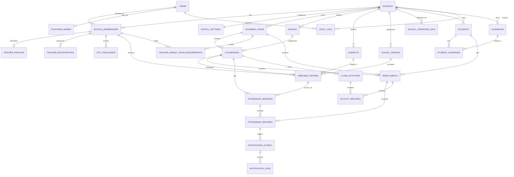

# ZangYar Data Model

## Design principles

- PostgreSQL is a shared database with shared tables.
- `schools` is the tenant root.
- Every school-owned entity has an explicit non-null `schoolId`.
- Users are global; school membership supplies school-level roles.
- Parents and guardians are contact records, not authenticated users.
- Composite foreign keys should enforce same-school relationships wherever practical.
- Historical records are archived or closed rather than deleted.
- Use UUID primary keys, `timestamptz` for instants, and PostgreSQL `date` for school-local business dates.

## Entity relationship diagram



## Entities and ownership

### Platform and tenancy

| Entity | Ownership | Cardinality and lifecycle |
|---|---|---|
| `users` | Global | One account can have many school memberships. Managed with the authentication system. Login identity is the unique `phoneNumber` (canonical `09XXXXXXXXX`); `phoneNumberVerified` must be true for sign-in. `email` remains a required unique column because Better Auth identity rows still carry one. |
| `platform_admins` | Platform | Explicit platform authorization for a user; may be revoked without changing school memberships. |
| `schools` | Tenant root | Created, activated, suspended, and archived. Historical records remain linked. |
| `school_memberships` | School | Exactly one membership per user/school; each membership has exactly one role, either School Admin or Teacher. Status is `ACTIVE`, `SUSPENDED`, `REVOKED`, `PENDING_ADMIN_APPROVAL`, or `REJECTED`. Only `ACTIVE` grants school access, so teacher approval is the transition into it. |
| `school_settings` | School | One-to-one configuration record; created with or shortly after a school. |
| `teacher_profiles` | School | One-to-one with a School Membership. Holds teacher-only attributes that are meaningful within a single school: the personnel code (supplied by the teacher at registration, optional, unique per school when present) and the name. Retained when a teacher is deactivated. |
| `teacher_registrations` | School | An authorized mobile number. Exists before any account does, which is why it is not a membership: `school_memberships.userId` is required. Holds only the number: name and personnel code are the teacher's own details, recorded on the profile at registration. Status is `PENDING` (authorized, unclaimed) or `CLAIMED` (a membership was created); `REVOKED` remains in the enum for rows withdrawn under the earlier model. An unclaimed row is deleted outright when withdrawn, since nothing references it; a claimed row is durable — kept after registration as the record of who authorized what. |
| `otp_challenges` | School (when tenant-scoped) | One-time codes for mobile verification. Keyed by purpose and normalized number, with attempt count, expiry, and a single-pending rule per purpose and number. Only an HMAC-keyed hash of the code is stored. Separate from Better Auth's `verification` table, which the phone-number plugin fills with plaintext values. |

### Academic management

| Entity | Ownership | Cardinality and lifecycle |
|---|---|---|
| `academic_years` | School | A school has many over time; normally one active year. Closing atomically archives active enrollments in that year, does not alter student global status, and does not delete history. |
| `grades` | School | A school has many grade definitions; archive rather than delete when referenced. |
| `classrooms` | School and academic year | A classroom belongs to one academic year and grade; historical classrooms remain available for reporting. |
| `subjects` | School | School-local catalog; archive when no longer offered. |
| `school_settings` shift | School | The school's own timetable shape lives on its settings row: `shiftType` (morning, afternoon, or rotating weekly) and, for a rotating school, `rotationBaseDate`. One row per school, because a school has one period list and a period list belongs to one shift. |
| `school_periods` | School | One position in the school day: an `ordinal`, a `startTime`, and an `endTime`. No kind and no label — a period is identified by its place and described by its times, and breaks are not modelled at all. A period is naturally two hours. |
| `school_operating_days` | School | The weekdays the school runs on, one row per day, numbered 1 (Saturday) through 7 (Friday). Presence of the row is the fact. |
| `timetable_entries` | School, academic year, and classroom | One teaching hour: classroom, weekday, period, which hour of that period, subject, and the one teacher who holds it. Two entries per period are its two hours, so a period is a full lesson when both name the same teacher and subject and a split one when they differ. Unique per classroom hour, so a class cannot be double-booked. Archived rather than deleted once attendance references it. |
| `teacher_weekly_hour_requirements` | School and academic year | One mandatory weekly hour figure per teacher per academic year. This is the scheduling gate: a teacher with no row, or a row of zero, cannot be given timetable slots. Approval records the figure, and it can be corrected from the teacher's page. |

### Students and guardians

| Entity | Ownership | Cardinality and lifecycle |
|---|---|---|
| `students` | School | School-local identity; active, withdrawn, graduated, or archived. Student lifecycle uses a dedicated status enum; historical rows are retained. |
| `guardians` | School | Contact record; may link to many students in the same school. |
| `student_guardians` | School | Many-to-many association with relationship and notification flags. |
| `enrollments` | School, academic year, classroom | Associates a student with a class for an effective date range. Multiple sequential enrollments per student/year support classroom transfers; date ranges must not overlap. |

### Attendance and activities

| Entity | Ownership | Cardinality and lifecycle |
|---|---|---|
| `attendance_sessions` | School, classroom, and timetable hour | One session per timetable entry per business date, so a class has one session per teaching hour it meets. Names the responsible teacher and subject directly, and stores the submission deadline it was created under. |
| `attendance_records` | School and session/enrollment | One status per enrollment in a session; corrections update the record and create audit history. |
| `class_activities` | School and classroom | Classroom event with date/category/description; may be archived. |
| `activity_records` | School and activity/enrollment | One student outcome per activity/enrollment. |

### Notifications and auditing

| Entity | Ownership | Cardinality and lifecycle |
|---|---|---|
| `notification_outbox` | School | Created transactionally by a source event; pending, processing, sent, failed, or cancelled. Retained for delivery history. |
| `notification_logs` | School and outbox item | Many provider attempts per outbox item. Append-only delivery/provider history. |
| `audit_logs` | School or platform | Append-only security and business event history. Platform events may have a null school. |

## Recommended fields and constraints

### `users`

Global identity, managed with the authentication system. `phoneNumber` is the login identity and is unique across the platform; it is stored in the canonical Iranian mobile format `09XXXXXXXXX`. `phoneNumberVerified` must be true before the account can sign in. `email` stays required and unique because Better Auth identity rows and account provisioning still provide one. A user identity is never duplicated for joining another school — additional schools are added as additional memberships.

### `schools`

Identity, name, slug/code, status, timezone (default `Asia/Tehran`), contact fields, and created/updated timestamps. `slug` should be globally unique.

### `school_memberships`

`schoolId`, `userId`, role, status, created/suspended/revoked timestamps. Recommended unique constraint: `(schoolId, userId)`. The role is a single enum value and must be either `SCHOOL_ADMIN` or `TEACHER`; do not introduce a membership-role join table for the MVP. A Teacher assignment must reference a membership whose role is `TEACHER`.

### `teacher_profiles` and `teacher_registrations`

`teacher_profiles` is one-to-one with a school membership and carries `schoolId`, `membershipId`, `personnelCode`, `firstName`, and `lastName`. `(schoolId, membershipId)` is a composite foreign key into `school_memberships`, so a profile can never describe a membership in another school, and `membershipId` is unique. The personnel code is unique within a school when present, via a partial unique index on `(schoolId, personnelCode) WHERE personnelCode IS NOT NULL`; the same code may exist in another school. It is optional and is supplied by the teacher at registration, because it is their own employment detail rather than something the admin can assert; a School Admin can correct it afterwards. Deactivation suspends the membership and leaves the profile row in place. The profile is created when the teacher registers, because only then does a membership exist to attach it to.

`teacher_registrations` records a mobile number a School Admin has authorized: `schoolId`, `phoneNumber` (canonical `09XXXXXXXXX`), `status`, an optional `membershipId`, and `claimedAt` / `revokedAt` / `createdByUserId`. It carries no name and no personnel code: those are the teacher's own school-local details and belong on the profile their registration creates, so the authorization row holds only what the admin is entitled to assert. A partial unique index on `(schoolId, phoneNumber) WHERE status <> 'REVOKED'` allows one live authorization per number per school, and lets a withdrawn number be authorized again. `(schoolId, membershipId)` is a composite foreign key into `school_memberships`, which tolerates a null membership while unclaimed and enforces same-school once set. A number may be authorized by several schools, and one identity then holds a membership at each.

Withdrawing an unclaimed number deletes the row rather than flagging it: the record is the admin's own assertion about a number nobody owns, so there is no membership, profile, or account to orphan, and the withdrawal is preserved as an audit event written in the same transaction. Deleting also frees the number to be authorized again. Correcting or deleting is refused once the row is `CLAIMED`, because the number is then the person's login identity (ADR-019) — ending their access is a membership decision, not a registration one.

The table is durable rather than consumed on registration: it is the record of who authorized which number, and it keeps an authorized-but-unclaimed number visible to the admin. This is separate from membership state (which answers whether the person may access the school) and from identity (which is created only at registration).

### `otp_challenges`

`purpose`, `phoneNumber` (canonical `09XXXXXXXXX`), `codeHash` (HMAC-SHA256 hex), `status` (`PENDING`/`CONSUMED`/`REVOKED`/`EXHAUSTED`), `attemptCount`, `maxAttempts`, `expiresAt`, `consumedAt`, `revokedAt`, `provider`, and optional `schoolId`/`membershipId`.

Purpose and number together identify a challenge, so a code issued for one purpose cannot satisfy another, and a partial unique index on `(purpose, phoneNumber) WHERE status = 'PENDING'` allows at most one live challenge. Requesting a new code revokes the current pending row first, which is how a resend invalidates the previous code rather than leaving two usable. A composite foreign key on `(schoolId, membershipId)` into `school_memberships` means a tenant-scoped challenge cannot reference another school's membership. A check constraint keeps `attemptCount` within `maxAttempts`.

This table is deliberately not Better Auth's `verification`: that table has no purpose, attempt ceiling, cooldown, or membership link, and its phone-number plugin writes codes in plaintext.

### `school_settings` notification policy

Store the school-level attendance notification policy in the one-to-one school settings record. The initial policy should expose one admin-configurable boolean per attendance status: `notifyOnPresent`, `notifyOnAbsent`, `notifyOnLate`, and `notifyOnExcused`. Attendance submission reads this policy and snapshots the selected decision into each outbox item. Activity notifications are not included in the initial policy.

### `academic_years`

`schoolId`, code/name, Gregorian start date, Gregorian end date, status, created/closed timestamps. The application may accept Persian-calendar input and converts it before persistence. Unique `(schoolId, code)`. Validate start date before end date. A partial unique index enforces one active year per school. Closing is a coordinated transaction: the year becomes `CLOSED` and only its `ACTIVE` enrollments become archived with an end date at the year end; already terminal enrollments, students, classrooms, and other academic years remain unchanged. Repeating closure is an idempotent no-op.

### `grades`, `subjects`, and `classrooms`

Use school-local codes. Recommended uniqueness:

- `grades(schoolId, code)`
- `subjects(schoolId, code)`
- `classrooms(schoolId, academicYearId, code)`

A classroom references an academic year and grade from the same school through composite foreign keys.

### `school_settings` shift, `school_periods`, and `school_operating_days`

The school's shift is two columns on its settings row rather than a table. `shiftType` is `MORNING`, `AFTERNOON`, or `ROTATING`, and `rotationBaseDate` is set exactly when the shift rotates — enforced by a check — because a fixed shift has no rotation to anchor. The week containing the base date is a morning week and each following week alternates, so which shift is in session on a date is reproducible from the row rather than from when it was configured. A school has one period list and a period list belongs to one shift, so a table of shifts would have held either a single row or a set of rows sharing one period list; putting the two columns here instead is what keeps the model honest.

`school_periods` carries `schoolId`, `ordinal`, `startTime`, and `endTime`. Unique `(schoolId, ordinal)`, checked `startTime < endTime` and `ordinal > 0`. There is deliberately no kind, no label, and no hour count: a period is a position in the day described by when it starts and ends, and the gap between one period's end and the next one's start *is* the break, so nothing has to be configured to express it. A period is naturally two hours; how many of them an assignment consumes is the assignment's business, not the period's.

`school_operating_days` carries `schoolId` and `dayOfWeek`, primary keyed on both, with 1 = Saturday through 7 = Friday enforced by a check. Storing the set as rows rather than as seven booleans keeps it queryable and orderable like every other relationship here.

A period is deleted only while no timetable assignment references it — a mistyped time is configuration and removable, whereas a period that has been scheduled is record. Operating days cannot be reduced while an assignment names a removed day, or while any attendance exists; both are refusals with a sentence rather than a silent partial state.

### `timetable_entries`

Carries `schoolId`, `academicYearId`, `classroomId`, `periodId`, `dayOfWeek`, `hourIndex`, `subjectId`, `teacherMembershipId`, and `status`. Unique `(schoolId, classroomId, dayOfWeek, periodId, hourIndex)` is the double-booking guard: a class occupies each hour of a slot once. There is no `shiftId`: the school has one period list, so a period already implies its shift.

`hourIndex` is 1 or 2, checked, because a period holds exactly two hours. That single column is what replaced the `scope`, `hourCount`, `partnerTeacherMembershipId`, `rotation`, and `rotationBaseDate` columns of the previous shape: those all existed to describe how one row covered a period, and numbering the row's hour makes the question disappear. A full lesson is two rows that name the same teacher and subject; a single hour is one row; a period split between two lessons is two rows that differ. Nothing records which of the three a period is, because the rows already say, and no two of them can disagree.

Composite foreign keys pin the entry to one school throughout: the classroom is tied to both the school and the academic year, the period to the school, the subject to the school, and the teacher to a same-school membership. The teacher-role and mandatory-hours requirements are enforced in the service layer, since a foreign key cannot express either. The mandatory-hours limit is checked against the hours the teacher *would* hold after the write, so re-saving a cell they already own is not read as a new hour.

This table absorbed what `class_teachers` used to hold. An assignment with only a date range could not answer when a teacher teaches or how many hours that is worth, and its `subjectId`/`isPrimary` pair described two different relationships in one row. The homeroom teacher that briefly lived on `classrooms` is gone as well: a class names no teacher of its own, because every teacher relationship it has is one of the hours inside it, and teacher access to a classroom is that membership alone.

### `teacher_weekly_hour_requirements`

Carries `schoolId`, `academicYearId`, `teacherMembershipId`, and `requiredWeeklyHours`, unique on `(schoolId, teacherMembershipId, academicYearId)` and checked non-negative. Per year rather than per profile, because the obligation is agreed for a year and storing it on the profile would rewrite history every September. Assigned hours are never stored: they are counted from the year's active timetable entries, one hour per entry that names the teacher, so the report cannot drift from the schedule it describes — and because an entry is an hour, the count needs no arithmetic that could disagree with the rows.

The figure is written in two places and neither is a duplicate of the other: `setTeacherStatus` records it inside the approval transaction, so approving a teacher cannot leave them unconfigured, and `setTeacherWeeklyHours` corrects it later, which is how a teacher approved before the rule existed is brought into line. Both require the school to have an `ACTIVE` academic year, because the obligation belongs to a year. Zero and missing are the same answer to the gate — see `src/features/teachers/hours.ts` — so a school that owes a teacher nothing should leave the row absent rather than record a zero that would read identically while implying a decision was made. The same figure is the ceiling the assignment service enforces, so a teacher cannot be scheduled past what the school recorded for them.

### `students`

School-local admission/student number, name, optional national identifier, date of birth, status, and timestamps. Recommended unique `(schoolId, admissionNumber)`. If national ID is provided, normalize it and enforce uniqueness within the school; do not enforce platform-wide uniqueness.

### `guardians` and `student_guardians`

Store a normalized mobile number for matching and delivery, plus an optional email address. A non-null normalized mobile number is unique within a school via `(schoolId, normalizedMobile)`; a guardian without a mobile number is not eligible for SMS. `student_guardians` requires a non-empty relationship type, is unique on `(schoolId, studentId, guardianId)`, and includes primary, emergency, and SMS-recipient flags. A partial unique index may enforce one primary guardian per student. Registration matches active guardians by normalized mobile within the school, then creates or updates the student relationship in the same transaction as the student profile and optional enrollment.

### `enrollments`

References school, student, academic year, and classroom and includes `startDate` (inclusive), `endDate` (exclusive, nullable for an open current enrollment), and status. Enrollment is separate from the student profile: a student keeps one profile row across academic years and gains one enrollment row per year, so re-enrollment never duplicates identity. Composite foreign keys ensure all references are same-school and classroom/year-compatible. Multiple sequential enrollments are allowed for classroom transfers, but date ranges for the same student and academic year must not overlap. PostgreSQL enforces this with a range exclusion constraint. A transfer closes the prior enrollment and creates a new enrollment; attendance remains linked to the enrollment that was effective on the attendance business date. Closing an academic year archives only active enrollments in that year; reactivating a student profile never reopens historical enrollments.

### `attendance_sessions`

References school, classroom, academic year, timetable entry, subject, business date, responsible teacher membership, creator membership, and status, plus `submissionDeadlineAt`. Unique `(schoolId, timetableEntryId, businessDate)`: attendance is recorded per teaching hour, so a class has one session for each hour it meets rather than one per day, and the two hours of a period are two sessions because they may be two different lessons.

The session carries `subjectId` and `teacherMembershipId` explicitly rather than leaving them to be derived from the timetable, because the assignment a session belongs to can be re-pointed at a different teacher or lesson, and the record of who owed the submission must not move when the timetable is later edited. It retains its academic year even if the classroom configuration changes.

`submissionDeadlineAt` is computed at session creation from the school's `attendanceSubmissionMinutes` window and the period's end time, resolved in the school's timezone, and stored rather than derived: the deadline a teacher was working to must not shift when the school later edits its timetable or its policy. A School Admin is exempt from the deadline — correction is their job — but not from the shift and weekday rules, since a period that never happened has nothing to correct.

There is no session-kind column: the daily/lesson enum existed for a future that has arrived, and per-hour sessions made it redundant, so it was dropped rather than left holding a value nothing produces.

### `attendance_records`

References school, session, enrollment, and classroom. Recommended unique `(schoolId, attendanceSessionId, enrollmentId)`. Composite constraints prevent a record for an enrollment from another school or classroom. Status is one of `PRESENT`, `ABSENT`, `LATE`, or `EXCUSED`. Teachers may correct same-day records for the periods they hold; School Admins may correct records for any school date. Corrections are audited.

### `class_activities` and `activity_records`

Activities reference school, classroom, academic year, date, category, and creator. Activity records reference the same-school activity and enrollment. Recommended unique `(schoolId, classActivityId, enrollmentId)`.

### `notification_outbox`

Include school, event type, source attendance/activity reference, guardian reference, recipient mobile snapshot, message snapshot, notification-policy decision/snapshot, idempotency key, status, attempt count, next-attempt timestamp, error details, and processing timestamps. Phase 6 creates one pending attendance intent per eligible active SMS guardian in the same transaction as the attendance record; disabled policy statuses and ineligible guardians create no row. Same-status resubmission uses a deterministic key scoped to school, attendance record, guardian, and resulting status. School Admins configure attendance event triggers in school settings. For the MVP, prefer concrete source foreign keys for attendance notifications over a generic polymorphic reference. Unique `(schoolId, idempotencyKey)`.

### `notification_logs`

Reference outbox item and school. Store provider name, provider message ID, attempt status, response metadata, error category, and timestamps. Keep logs append-only.

### `audit_logs`

Include nullable school, actor user, optional actor membership, action, entity type/id, structured metadata, request metadata, and occurrence timestamp. Platform-level actions may have no school. Tenant context must be explicit even if entity IDs are globally unique.

## Tenant ownership matrix

| Entity | Explicit `schoolId` | Database protection |
|---|---:|---|
| `users` | No | Global identity. |
| `platform_admins` | No | Explicit platform authorization. |
| `schools` | Root ID | Tenant root. |
| `school_memberships` | Yes | Unique school/user and user-to-school membership. |
| `school_settings` | Yes | One-to-one school foreign key. |
| `teacher_profiles` | Yes | Composite reference to the membership's own school; unique membership. |
| `teacher_registrations` | Yes | Composite reference to the membership's own school once claimed; one live authorization per number per school. |
| `otp_challenges` | Yes (nullable) | Nullable composite reference for tenant-scoped purposes; null for login and password reset, which are not tenant-bound. |
| `academic_years`, `grades`, `subjects` | Yes | School-scoped unique codes. |
| `classrooms` | Yes | Composite references to school/year/grade. |
| `school_periods`, `school_operating_days` | Yes | School-scoped period list keyed on `(schoolId, ordinal)`, and an operating-day set keyed on `(schoolId, dayOfWeek)`. |
| `timetable_entries` | Yes | Same-school classroom/year, period, subject, and teacher composite references. |
| `teacher_weekly_hour_requirements` | Yes | Same-school membership and academic-year composite references. |
| `students`, `guardians` | Yes | School-scoped identity and contact constraints. |
| `student_guardians` | Yes | Same-school student and guardian composite references. |
| `enrollments` | Yes | Same-school student/classroom/year composite references. |
| Attendance and activity entities | Yes | Same-school session, activity, enrollment, and classroom references. |
| Notifications | Yes | Same-school source, guardian, and outbox references. |
| `audit_logs` | Nullable | Explicit tenant context for school events; platform events may be null. |

Every school-owned join table carries `schoolId`, even when derivable. This keeps tenant scopes explicit and enables composite foreign keys.

## Important database rules

- Use restrictive foreign-key deletes for historical entities.
- Prefer status/archive transitions over deleting schools, students, academic years, attendance, notifications, or audit records.
- Normalize mobile numbers before uniqueness and delivery.
- Use partial unique indexes for one active academic year, one primary guardian, and other explicitly accepted singleton rules.
- Use a school-scoped partial unique index for non-null normalized national IDs.
- Store notification recipient and message snapshots so later contact edits do not rewrite delivery history.
- Do not destructively delete records referenced by operational history; use archive/status transitions.
- Use a pending-outbox index beginning with `(schoolId, status, nextAttemptAt)` or an equivalent partial index for the worker.

## Index strategy

Tenant-scoped indexes should normally begin with `schoolId`:

```text
school_memberships(school_id, user_id)
school_memberships(school_id, role, status)
teacher_profiles(school_id, last_name, first_name) -- partial unique on (school_id, personnel_code) where not null
teacher_registrations(school_id, status) -- partial unique on (school_id, phone_number) where not revoked
otp_challenges(purpose, phone_number, created_at) -- partial unique pending per purpose+number
otp_challenges(expires_at) -- for later cleanup of lapsed challenges
academic_years(school_id, status)
classrooms(school_id, academic_year_id, grade_id)
school_periods(school_id, ordinal)
timetable_entries(school_id, teacher_membership_id, status)
timetable_entries(school_id, classroom_id, day_of_week)
teacher_weekly_hour_requirements(school_id, academic_year_id)
students(school_id, admission_number)
students(school_id, status)
guardians(school_id, normalized_mobile) -- partial unique index where normalized_mobile is not null
student_guardians(school_id, student_id)
student_guardians(school_id, guardian_id)
enrollments(school_id, academic_year_id, classroom_id)
enrollments(school_id, student_id, academic_year_id, start_date)
-- exclusion constraint prevents overlapping student/year enrollment ranges
attendance_sessions(school_id, classroom_id, business_date)
attendance_sessions(school_id, teacher_membership_id, business_date)
attendance_sessions(school_id, status, submission_deadline_at)
attendance_records(school_id, attendance_session_id)
attendance_records(school_id, enrollment_id)
class_activities(school_id, classroom_id, activity_date)
activity_records(school_id, class_activity_id)
activity_records(school_id, enrollment_id)
notification_outbox(school_id, status, next_attempt_at)
notification_logs(school_id, notification_outbox_id)
audit_logs(school_id, occurred_at)
audit_logs(actor_user_id, occurred_at)
```

## Confirmed design decisions

- A school membership has exactly one role: `SCHOOL_ADMIN` or `TEACHER`.
- Classroom transfers are supported through non-overlapping effective-dated enrollments.
- School Admins configure attendance SMS triggers in the admin panel; activity notifications are not part of the initial policy.
- Non-null normalized guardian mobile numbers are unique within a school.
- Teachers may correct same-day attendance for assigned classrooms; School Admins may correct any school date; all corrections are audited.
- National ID is optional and, when present, is unique within the school.
- User-facing Persian-calendar dates are converted to Gregorian dates before storage.
- Subject teachers belong to the weekly timetable, not to a classroom-level assignment record; a classroom names no teacher of its own.
- A period is naturally two hours and carries no kind, label, or duration of its own; breaks are gaps between periods rather than configured rows.
- An assignment is one teaching hour: a period holds two of them, so a period taught whole is two rows naming the same teacher and subject and a period split between two lessons is two rows that differ.
- A rotating school's shift alternates weekly from a stored base date, and the shift that actually ran is recorded on each attendance session.
- A school's week runs Saturday (1) through Friday (7).
- Operational records use archive/status transitions instead of destructive deletion in the MVP.
- Formal guardian-consent workflows are deferred; SMS eligibility remains explicit on the student-guardian relationship.
- Student lifecycle uses `ACTIVE`, `WITHDRAWN`, `GRADUATED`, and `ARCHIVED`; non-active profiles may be explicitly reactivated, which changes only global profile status and never reopens enrollments or assigns a classroom.
- Guardian mobile and student national ID are normalized at the application boundary before school-scoped uniqueness checks.
- Student-guardian relationship rows are retained; new links require a relationship type, and SMS eligibility requires a valid normalized mobile.
- Teacher registration state is separate from membership state: an authorization answers whether a number may register, a membership answers whether the person may access the school.
- A provisioned teacher has no credential account until they complete activation, so no enabled sign-in path can authenticate them beforehand.
- A mobile number may be authorized once per school; withdrawing an unclaimed authorization deletes it and frees the number to be re-added.
- Approval is the transition into `ACTIVE`, so approving, rejecting, deactivating, and reactivating a teacher are one guarded operation rather than four; the legal moves from each membership status are declared once in the teacher status module.
- OTP codes are stored only as an HMAC-keyed hash and are single-use; requesting a new code invalidates any outstanding one for the same purpose.
- A verification code is scoped by purpose as well as by number, so a code issued for one flow cannot satisfy another.
- PostgreSQL range exclusion enforces non-overlapping enrollment ranges; adjacent `[startDate, endDate)` transfers remain valid.

## Deferred design questions

These do not block initial schema implementation:

1. Whether activity events should later be added to the notification policy.
2. Whether a formal attendance finalization workflow should be introduced later.
3. Detailed guardian-consent and regulatory retention requirements.
