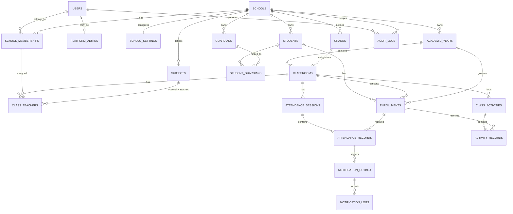

# ZangYar Data Model

## Design principles

- PostgreSQL is a shared database with shared tables.
- `schools` is the tenant root.
- Every school-owned entity has an explicit non-null `schoolId`.
- Users are global; school membership supplies school-level roles.
- Parents and guardians are contact records, not authenticated users.
- Composite foreign keys should enforce same-school relationships wherever practical.
- Historical records are archived or closed rather than deleted.
- Use UUID primary keys, `timestamptz` for instants, and PostgreSQL `date` for school-local business dates.

## Entity relationship diagram



## Entities and ownership

### Platform and tenancy

| Entity | Ownership | Cardinality and lifecycle |
|---|---|---|
| `users` | Global | One account can have many school memberships. Managed with the authentication system. |
| `platform_admins` | Platform | Explicit platform authorization for a user; may be revoked without changing school memberships. |
| `schools` | Tenant root | Created, activated, suspended, and archived. Historical records remain linked. |
| `school_memberships` | School | Exactly one membership per user/school; each membership has exactly one role, either School Admin or Teacher. Status may be active, suspended, or revoked. |
| `school_settings` | School | One-to-one configuration record; created with or shortly after a school. |

### Academic management

| Entity | Ownership | Cardinality and lifecycle |
|---|---|---|
| `academic_years` | School | A school has many over time; normally one active year. Closing does not delete history. |
| `grades` | School | A school has many grade definitions; archive rather than delete when referenced. |
| `classrooms` | School and academic year | A classroom belongs to one academic year and grade; historical classrooms remain available for reporting. |
| `subjects` | School | School-local catalog; archive when no longer offered. |
| `class_teachers` | School | Many-to-many classroom/teacher assignment, optionally subject-specific; assignment may have dates. |

### Students and guardians

| Entity | Ownership | Cardinality and lifecycle |
|---|---|---|
| `students` | School | School-local identity; active, withdrawn, graduated, or archived. |
| `guardians` | School | Contact record; may link to many students in the same school. |
| `student_guardians` | School | Many-to-many association with relationship and notification flags. |
| `enrollments` | School, academic year, classroom | Associates a student with a class for an effective date range. Multiple sequential enrollments per student/year support classroom transfers; date ranges must not overlap. |

### Attendance and activities

| Entity | Ownership | Cardinality and lifecycle |
|---|---|---|
| `attendance_sessions` | School and classroom | One daily session per classroom/local date in the MVP; session kind permits future lesson-level sessions. |
| `attendance_records` | School and session/enrollment | One status per enrollment in a session; corrections update the record and create audit history. |
| `class_activities` | School and classroom | Classroom event with date/category/description; may be archived. |
| `activity_records` | School and activity/enrollment | One student outcome per activity/enrollment. |

### Notifications and auditing

| Entity | Ownership | Cardinality and lifecycle |
|---|---|---|
| `notification_outbox` | School | Created transactionally by a source event; pending, processing, sent, failed, or cancelled. Retained for delivery history. |
| `notification_logs` | School and outbox item | Many provider attempts per outbox item. Append-only delivery/provider history. |
| `audit_logs` | School or platform | Append-only security and business event history. Platform events may have a null school. |

## Recommended fields and constraints

### `schools`

Identity, name, slug/code, status, timezone (default `Asia/Tehran`), contact fields, and created/updated timestamps. `slug` should be globally unique.

### `school_memberships`

`schoolId`, `userId`, role, status, created/suspended/revoked timestamps. Recommended unique constraint: `(schoolId, userId)`. The role is a single enum value and must be either `SCHOOL_ADMIN` or `TEACHER`; do not introduce a membership-role join table for the MVP. A Teacher assignment must reference a membership whose role is `TEACHER`.

### `school_settings` notification policy

Store the school-level attendance notification policy in the one-to-one school settings record. The initial policy should expose one admin-configurable boolean per attendance status: `notifyOnPresent`, `notifyOnAbsent`, `notifyOnLate`, and `notifyOnExcused`. Attendance submission reads this policy and snapshots the selected decision into each outbox item. Activity notifications are not included in the initial policy.

### `academic_years`

`schoolId`, code/name, Gregorian start date, Gregorian end date, status, created/closed timestamps. The application may accept Persian-calendar input and converts it before persistence. Unique `(schoolId, code)`. Validate start date before end date. A partial unique index may enforce one active year per school if that is the accepted policy.

### `grades`, `subjects`, and `classrooms`

Use school-local codes. Recommended uniqueness:

- `grades(schoolId, code)`
- `subjects(schoolId, code)`
- `classrooms(schoolId, academicYearId, code)`

A classroom references an academic year and grade from the same school through composite foreign keys.

### `class_teachers`

References a classroom and a teacher membership from the same school. The membership must have a teacher-capable role. Optional subject reference must also be same-school. Recommended uniqueness is `(schoolId, classroomId, teacherMembershipId, subjectId)` with a clear null-subject strategy.

### `students`

School-local admission/student number, name, optional national identifier, date of birth, status, and timestamps. Recommended unique `(schoolId, admissionNumber)`. If national ID is provided, normalize it and enforce uniqueness within the school; do not enforce platform-wide uniqueness.

### `guardians` and `student_guardians`

Store a normalized mobile number for matching and delivery. A non-null normalized mobile number is unique within a school via `(schoolId, normalizedMobile)`; a guardian without a mobile number is not eligible for SMS. `student_guardians` is unique on `(schoolId, studentId, guardianId)` and includes relationship, primary, emergency, and SMS-recipient flags. A partial unique index may enforce one primary guardian per student.

### `enrollments`

References school, student, academic year, and classroom and includes `startDate` (inclusive), `endDate` (exclusive, nullable for an open current enrollment), and status. Composite foreign keys ensure all references are same-school and classroom/year-compatible. Multiple sequential enrollments are allowed for classroom transfers, but date ranges for the same student and academic year must not overlap. PostgreSQL should enforce this with a range exclusion constraint where practical, for example a school/student/year equality plus `daterange(startDate, endDate, '[)')` overlap exclusion. A transfer closes the prior enrollment and creates a new enrollment; attendance remains linked to the enrollment that was effective on the attendance business date.

### `attendance_sessions`

References school, classroom, academic year, local business date, session kind, creator membership, and status. Recommended unique `(schoolId, classroomId, businessDate, sessionKind)` for daily uniqueness. The session should retain its academic year even if the classroom configuration later changes. Teachers may correct same-day records for assigned classrooms; School Admins may correct records for any school date. All corrections are audited.

### `attendance_records`

References school, session, enrollment, and classroom. Recommended unique `(schoolId, attendanceSessionId, enrollmentId)`. Composite constraints should prevent a record for an enrollment from another school or classroom. Status is one of `PRESENT`, `ABSENT`, `LATE`, or `EXCUSED`. Teachers may correct same-day records for assigned classrooms; School Admins may correct records for any school date. Corrections are audited.

### `class_activities` and `activity_records`

Activities reference school, classroom, academic year, date, category, and creator. Activity records reference the same-school activity and enrollment. Recommended unique `(schoolId, classActivityId, enrollmentId)`.

### `notification_outbox`

Include school, event type, source attendance/activity reference, guardian reference, recipient mobile snapshot, message snapshot, notification-policy decision/snapshot, idempotency key, status, attempt count, next-attempt timestamp, error details, and processing timestamps. School Admins configure attendance event triggers in school settings. For the MVP, prefer concrete source foreign keys for attendance notifications over a generic polymorphic reference. Unique `(schoolId, idempotencyKey)`.

### `notification_logs`

Reference outbox item and school. Store provider name, provider message ID, attempt status, response metadata, error category, and timestamps. Keep logs append-only.

### `audit_logs`

Include nullable school, actor user, optional actor membership, action, entity type/id, structured metadata, request metadata, and occurrence timestamp. Platform-level actions may have no school. Tenant context must be explicit even if entity IDs are globally unique.

## Tenant ownership matrix

| Entity | Explicit `schoolId` | Database protection |
|---|---:|---|
| `users` | No | Global identity. |
| `platform_admins` | No | Explicit platform authorization. |
| `schools` | Root ID | Tenant root. |
| `school_memberships` | Yes | Unique school/user and user-to-school membership. |
| `school_settings` | Yes | One-to-one school foreign key. |
| `academic_years`, `grades`, `subjects` | Yes | School-scoped unique codes. |
| `classrooms` | Yes | Composite references to school/year/grade. |
| `class_teachers` | Yes | Same-school classroom/membership/subject references. |
| `students`, `guardians` | Yes | School-scoped identity and contact constraints. |
| `student_guardians` | Yes | Same-school student and guardian composite references. |
| `enrollments` | Yes | Same-school student/classroom/year composite references. |
| Attendance and activity entities | Yes | Same-school session, activity, enrollment, and classroom references. |
| Notifications | Yes | Same-school source, guardian, and outbox references. |
| `audit_logs` | Nullable | Explicit tenant context for school events; platform events may be null. |

Every school-owned join table carries `schoolId`, even when derivable. This keeps tenant scopes explicit and enables composite foreign keys.

## Important database rules

- Use restrictive foreign-key deletes for historical entities.
- Prefer status/archive transitions over deleting schools, students, academic years, attendance, notifications, or audit records.
- Normalize mobile numbers before uniqueness and delivery.
- Use partial unique indexes for one active academic year, one primary guardian, and other explicitly accepted singleton rules.
- Use a school-scoped partial unique index for non-null normalized national IDs.
- Store notification recipient and message snapshots so later contact edits do not rewrite delivery history.
- Do not destructively delete records referenced by operational history; use archive/status transitions.
- Use a pending-outbox index beginning with `(schoolId, status, nextAttemptAt)` or an equivalent partial index for the worker.

## Index strategy

Tenant-scoped indexes should normally begin with `schoolId`:

```text
school_memberships(school_id, user_id)
school_memberships(school_id, role, status)
academic_years(school_id, status)
classrooms(school_id, academic_year_id, grade_id)
class_teachers(school_id, teacher_membership_id)
class_teachers(school_id, classroom_id)
students(school_id, admission_number)
students(school_id, status)
guardians(school_id, normalized_mobile) -- partial unique index where normalized_mobile is not null
student_guardians(school_id, student_id)
student_guardians(school_id, guardian_id)
enrollments(school_id, academic_year_id, classroom_id)
enrollments(school_id, student_id, academic_year_id, start_date)
-- exclusion constraint prevents overlapping student/year enrollment ranges
attendance_sessions(school_id, classroom_id, business_date)
attendance_records(school_id, attendance_session_id)
attendance_records(school_id, enrollment_id)
class_activities(school_id, classroom_id, activity_date)
activity_records(school_id, class_activity_id)
activity_records(school_id, enrollment_id)
notification_outbox(school_id, status, next_attempt_at)
notification_logs(school_id, notification_outbox_id)
audit_logs(school_id, occurred_at)
audit_logs(actor_user_id, occurred_at)
```

## Confirmed design decisions

- A school membership has exactly one role: `SCHOOL_ADMIN` or `TEACHER`.
- Classroom transfers are supported through non-overlapping effective-dated enrollments.
- School Admins configure attendance SMS triggers in the admin panel; activity notifications are not part of the initial policy.
- Non-null normalized guardian mobile numbers are unique within a school.
- Teachers may correct same-day attendance for assigned classrooms; School Admins may correct any school date; all corrections are audited.
- National ID is optional and, when present, is unique within the school.
- User-facing Persian-calendar dates are converted to Gregorian dates before storage.
- Subjects are optional for classroom-teacher assignments.
- Operational records use archive/status transitions instead of destructive deletion in the MVP.
- Formal guardian-consent workflows are deferred; SMS eligibility remains explicit on the student-guardian relationship.
- The initial schema uses effective-dated enrollment columns and application validation; PostgreSQL range exclusion for overlapping enrollments will be added when the enrollment service is implemented and tested.

## Deferred design questions

These do not block initial schema implementation:

1. Whether activity events should later be added to the notification policy.
2. Whether a formal attendance finalization workflow should be introduced later.
3. Detailed guardian-consent and regulatory retention requirements.
